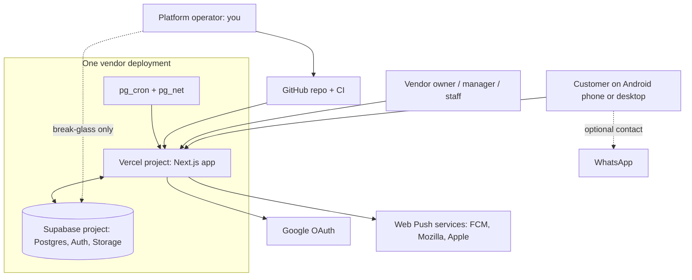
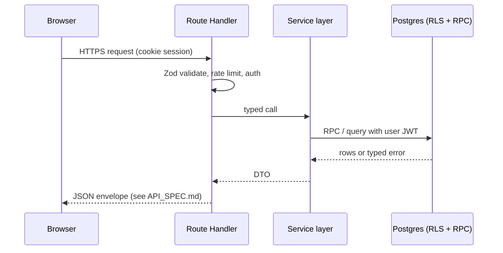
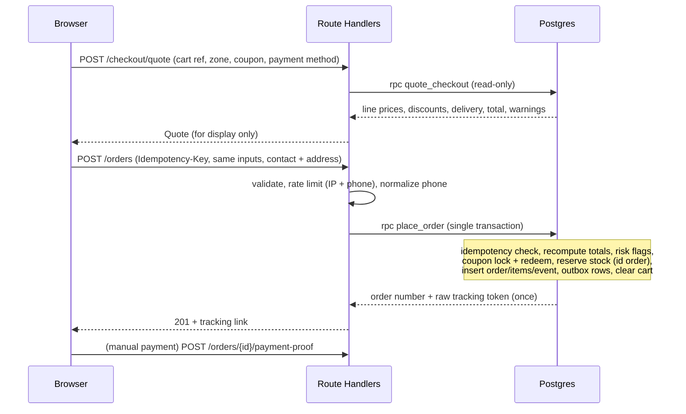
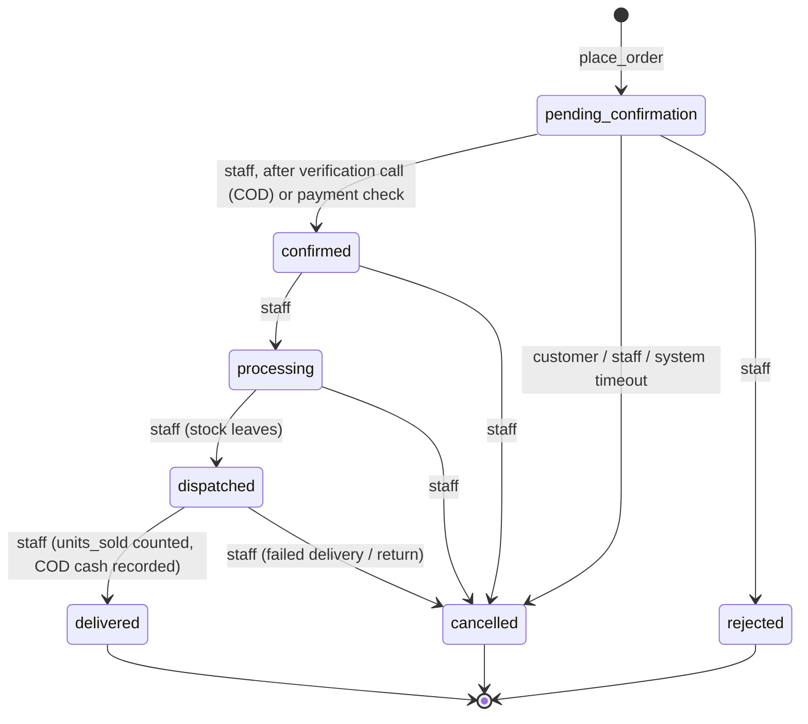
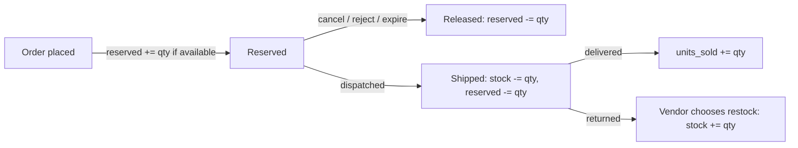
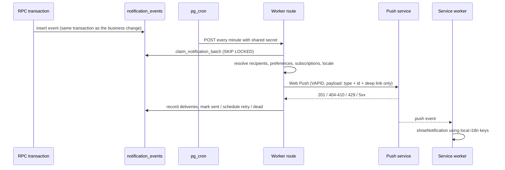
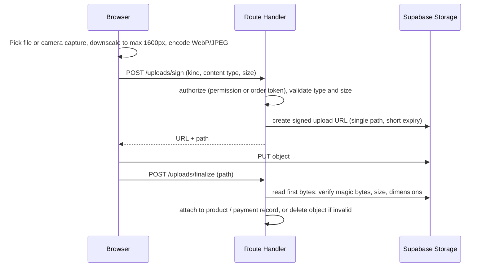
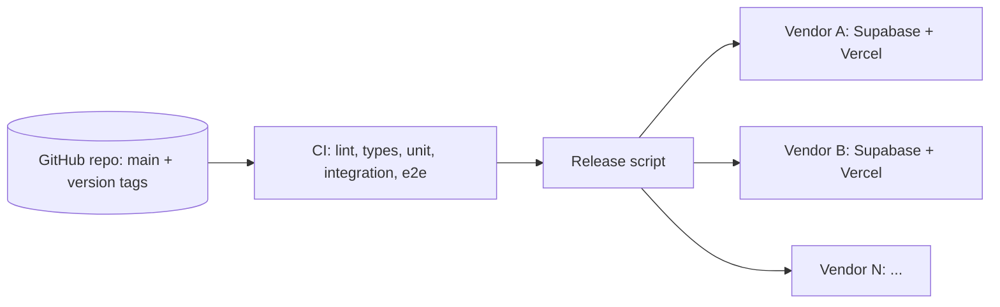
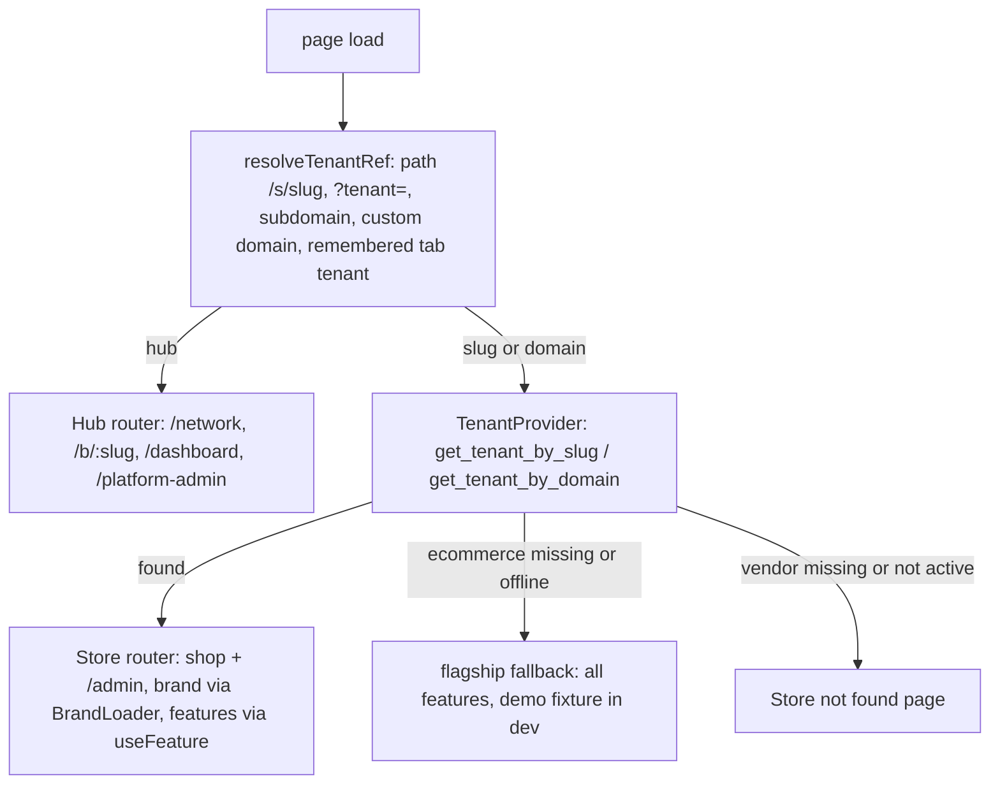

# ARCHITECTURE.md

Status: Draft v0.1 (planning). Consistent with DATABASE.md v0.1. Decision IDs refer to DECISIONS.md.

| ID | Decision |
|---|---|
| D-001 | Separate deployment, database and storage per vendor |
| D-002 | PostgreSQL on Supabase |
| D-003 | Supabase client + RLS + SQL migrations + RPC functions (no Prisma) |
| D-004 | Next.js as the application and API layer (no separate backend service) |
| D-005 | Auth: Google OAuth + guest checkout with token tracking |
| D-006 | Inventory: reserve at placement, release on cancel/reject/expiry |
| D-007 | Manual payments, vendor verification, gateway later |
| D-008 | Notification outbox processed by scheduled worker |
| D-009 | Localization with next-intl |
| D-010 | Installable PWA with restricted caching |
| D-011 | Vercel for hosting; Render as documented alternative |
| D-012 | No standing operator access to customer data; break-glass |
| D-013 | Versioned releases, scripted per-vendor rollout |

---

## 1. System context



External systems: Google (identity), browser push services, WhatsApp (deep link only, no API). No payment gateway in MVP (D-007).

---

## 2. Component responsibilities

| Component | Responsibility | Must not |
|---|---|---|
| Next.js Server Components | Render pages, read public/own data with the request-scoped Supabase client | Contain business rules or call service role |
| Next.js Route Handlers (`app/api/**`) | HTTP contract: parse and validate (Zod), authenticate, rate limit, call services, map errors | Contain SQL or pricing logic |
| Service layer (`src/server/services/*`) | Orchestrates RPC calls and storage operations, one module per feature | Import React or browser code |
| Postgres RPC functions | Authoritative business rules and transactions (checkout, transitions, stock, coupons) | Trust caller-supplied prices or totals |
| RLS policies | Default-deny data access by user and permission | Be the only control on sensitive writes (RPC also checks) |
| Client Components | Interaction (cart UI, forms, camera capture, push permission) | Hold secrets, compute totals for submission |
| Service worker | Offline shell, push display, notification click routing | Cache private or personalized data |
| Notification worker route | Claim outbox rows, send Web Push, record results, retry | Run without the shared secret |
| pg_cron | Triggers worker route and maintenance functions on a schedule | Hold business logic outside SQL functions |
| Release script | Migrate and deploy each vendor sequentially | Run unattended against production without a staging pass |

---

## 3. Code organization (repository layout)

```
/
  MASTER_IMPLEMENTATION_PROMPT.md
  docs/                      # all spec documents
  supabase/
    migrations/              # timestamped SQL, source of truth
    seed.sql                 # demo data (never run on vendor production)
    tests/                   # pgTAP or SQL-level tests for RLS and RPC
  src/
    app/
      [locale]/(storefront)/ # customer pages
      [locale]/(auth)/
      [locale]/admin/        # vendor dashboard
      api/                   # route handlers
      manifest.ts, sw.ts     # PWA
    features/                # feature modules: catalog, cart, checkout, orders, reviews, ...
      <feature>/{components,hooks,schemas,types}
    server/
      services/              # per-feature server services
      supabase/              # server client, admin client (isolated), types
      auth/                  # session helpers, permission checks
      notifications/         # outbox, web-push sender
      rate-limit/, errors/, logging/
    components/ui/           # shadcn/ui primitives
    lib/                     # money, i18n helpers, phone normalization
    messages/{en,ne}.json    # translation dictionaries
    config/                  # env validation (Zod), store config types
  scripts/                   # onboarding, release, backup, seed
  tests/{unit,integration,e2e}
  .github/workflows/
```

Rules: features own their UI and schemas; shared logic goes in `lib/`; only `src/server/supabase/admin.ts` may create a service-role client, and a lint rule forbids importing it from anywhere except `src/server/notifications`, maintenance routes and scripts.

---

## 4. Data flow (general)



Reads of public catalog data happen in Server Components using the same request-scoped client (anon or user JWT) so RLS applies identically to pages and APIs.

---

## 5. Authentication flow

```mermaid
sequenceDiagram
  participant U as User
  participant App as Next.js
  participant SA as Supabase Auth
  participant G as Google
  U->>App: Click "Continue with Google"
  App->>SA: signInWithOAuth (PKCE), redirectTo = allowlisted callback
  SA->>G: Authorization request
  G-->>SA: Code
  SA-->>App: /auth/callback?code=...
  App->>SA: exchange code for session
  App-->>U: Set httpOnly secure session cookies, redirect to validated "next" path
  Note over App: Middleware refreshes the session; staff status is read from staff_members on each admin request
```

- Sessions use Supabase SSR cookie handling (`@supabase/ssr`). Tokens are not placed in `localStorage`.
- `next` redirect targets are validated against a same-origin relative-path allowlist.
- Staff are invited by an owner: the invite creates a `staff_members` row bound to a verified email, activated on first Google sign-in with that email. Customers and staff share the Google login; permissions come only from `staff_members`.
- Guests have no auth session. Guest carts use an httpOnly random cookie whose hash is stored in `carts.guest_token_hash`.
- Admin routes check `has_permission` server-side on every request. Hiding menu items is cosmetic only.

---

## 6. Checkout flow



The client never submits prices or totals. If prices changed between quote and placement, `place_order` returns `PRICE_CHANGED` with the new quote and the UI asks the customer to confirm. Repeating the same `Idempotency-Key` with the same payload returns the original order; with a different payload it returns `IDEMPOTENCY_CONFLICT`.

---

## 7. Order state machine



Rules:
- Every transition goes through `transition_order`, which locks the order row, checks `expected_status`, enforces permission (`orders.manage`), writes `order_status_events`, audit and outbox rows in one transaction.
- `delivered`, `cancelled` and `rejected` are terminal. Corrections are made by payment/refund records, not by reopening orders.
- Payment status is an independent field: `unpaid`, `awaiting_verification`, `verified`, `rejected`, `refunded`. A manual-payment order may be `confirmed` while payment is still `awaiting_verification` only if the vendor chooses; the dashboard shows both states and warns.
- Cancelling after dispatch does not auto-restock; the vendor chooses `return_restock`.
- The allowed-transition table lives in SQL (`app_private.order_transition_allowed`) and is mirrored in TypeScript; a test asserts they match.

---

## 8. Inventory flow



Every arrow writes a `stock_movements` row. The conditional-update reservation and the `reserved_quantity <= stock_quantity` constraint are specified in DATABASE.md section 6. Low-stock events are queued when `stock_quantity - reserved_quantity` crosses the product threshold downward.

---

## 9. Notification flow



- **Reliability:** events are durable rows written transactionally. A crashed worker leaves `processing` rows; rows locked longer than a timeout are reclaimed.
- **Retries:** exponential backoff with jitter, max attempts (default 6), then `dead` and visible in the dashboard.
- **Cleanup:** 404/410 responses mark subscriptions revoked immediately; repeated failures revoke after a threshold.
- **Privacy:** payloads contain event type, order id and a deep link only. The service worker builds readable text from translation keys. No names, phones, addresses or totals.
- **Honest status:** the system records "submitted to push service", never "seen".
- **Fallback:** if permission is denied or unsupported, users see in-app status (order tracking page and dashboard notification list). Nothing important is notification-only.
- **Scheduler caveat:** pg_cron calling a Vercel route requires `pg_net` and a reachable public URL; if unavailable on a plan, the fallback is an external scheduler hitting the same route, or Vercel Cron on a paid plan (minute-level). Hobby supports only daily cron, so Hobby is not used for production (D-011).
- Worker route authenticates with a long random shared secret (header) compared in constant time, plus an IP-agnostic replay-safe design (idempotent processing).

---

## 10. File upload flow (product images, store assets, payment proofs)



- Unfinalized objects are removed by the purge job.
- Client-side resizing avoids relying on paid image-transformation features.
- Filenames are server-generated UUIDs; user-provided names are never used in paths.
- SVG and other active formats are rejected.

---

## 11. White-label deployment model

Per vendor: 1 Git deployment target (Vercel project), 1 Supabase project (production), shared **staging** pair (D-013 default), own subdomain, own secrets.



### Configuration placement

| Setting | Where | Why |
|---|---|---|
| Store name, logo, favicon, theme tokens, contact, WhatsApp, locales, policies, payment instructions, delivery defaults, expiry hours | `store_settings` (DB) | Vendor can edit without redeploy |
| Delivery zones, coupons | Tables | Operational data |
| Supabase URL, anon key, service-role key, DB credentials | Env vars (host secret store) | Secrets, per deployment |
| VAPID keys, worker shared secret, `STORE_SLUG`, `NEXT_PUBLIC_SITE_URL` | Env vars | Per deployment secrets and identity |
| Subdomain, HTTPS certificate, redirect URLs | Hosting + Supabase Auth settings | Infrastructure |
| Onboarding (create settings row, owner invite, seed zones) | Deployment script | Repeatable and reviewable |

Branding is read from `store_settings` at request time (cached with revalidation) and injected as CSS variables and metadata. No vendor name or color appears in components.

### Code reuse vs shared production infrastructure

- **Reused:** the codebase, migrations, test suite and release tooling are shared across vendors.
- **Not shared:** databases, storage, secrets, Auth users, and deployments are separate. A bug or breach in one vendor's database does not expose another's data, and restoring one vendor does not touch the others.
- **Cost of this choice:** each vendor adds hosting and database cost and an extra target for upgrades. The release script and version tracking (`store_settings.deployed_version`) exist to keep that manageable (D-001, D-013).
- A shared Vercel *team* account and a shared Supabase *organization* are administrative containers only. Operator credentials to them are high-value secrets (see SECURITY.md).

---

## 12. Environment separation

| Environment | Purpose | Data | Notes |
|---|---|---|---|
| Local | Development | Supabase CLI local stack + `seed.sql` | Never connects to staging or production |
| Preview | PR review | Staging Supabase project | Isolated test data |
| Staging | Release verification | Shared staging Supabase + Vercel project, demo data | Every release deploys here first |
| Demo | Vendor sales demo | Realistic seed data | Free tiers allowed per D-011 plan note; pauses after idle, wake before meetings; non-commercial-use risk checked in DEPLOYMENT.md |
| Production (per vendor) | Real store | Real data | Paid plans, backups on, secrets unique |

No production secret is ever used outside production. CI uses staging credentials only.

---

## 13. Server/client boundaries

- Server Components by default. A file becomes a Client Component only when it needs state, effects, browser APIs or event handlers.
- Environment variables prefixed `NEXT_PUBLIC_` contain only non-secret values (site URL, Supabase URL, anon key, VAPID **public** key).
- Money formatting and locale helpers are shared; **price calculation is not**: totals shown in the browser are display-only responses from `quote_checkout`.
- Zod schemas in `features/*/schemas` are shared for form validation, but the server always revalidates.
- `import 'server-only'` is used in service and admin-client modules so accidental client imports fail the build.

---

## 14. Database access strategy

- Three Supabase client factories: (1) browser anon client (only for auth state and realtime-free public reads if needed), (2) per-request server client carrying the user's session, (3) admin client (service role), isolated and lint-restricted.
- Reads: queries via the per-request client so RLS applies.
- Writes that affect money, stock, status or snapshots: RPC only.
- Types: generated from the schema (`supabase gen types`) and checked into the repo; CI fails if they are stale.
- Prisma is not used (D-003). Reason: Prisma's privileged connection bypasses RLS and would create a second, unsynchronized security model.

---

## 15. Error handling

- One error envelope for all APIs: `{ "error": { "code": "STRING_CODE", "message": "localized text", "details": {...}, "requestId": "..." } }` with consistent HTTP statuses (API_SPEC.md).
- Database exceptions use stable `SQLSTATE`/message codes (`INSUFFICIENT_STOCK`, `COUPON_UNAVAILABLE`, `INVALID_TRANSITION`, `STALE_STATUS`, `PRICE_CHANGED`) mapped centrally to HTTP errors.
- Unexpected errors return a generic message and a request id; details go to logs only.
- User-facing messages are translated; codes are stable.
- Client UI shows recoverable states (retry, edit cart) for stock and price conflicts.

---

## 16. Logging, monitoring

- **Logging:** structured JSON from route handlers and the worker: timestamp, level, request id, route, user id (not name/phone), outcome, duration. No PII, no tokens, no full payment references. Audit-relevant business events are in `audit_logs`, not only in logs.
- **Monitoring (low budget):**
  - External uptime check per vendor storefront and a `/api/health` route (DB reachability, version).
  - Worker health: alert if the oldest pending outbox row is older than 10 minutes or `dead` count rises. Exposed through a protected `/api/health/worker` route.
  - Hosting and Supabase dashboards for errors and usage; an optional error tracker (for example Sentry) is an **optional enhancement**, only added with justification.
  - Usage review per vendor monthly: database size, storage, egress against plan limits.

---

## 17. Backup and recovery

See DATABASE.md section 13 and DEPLOYMENT.md. Summary: paid-plan provider backups, additional encrypted weekly dumps, separate storage-object backups, restore into a new project, documented and rehearsed restore, per-vendor isolation of recovery.

---

## 18. PWA behavior (D-010)

- Web app manifest generated from `store_settings` (name, theme color, icons).
- Service worker caches only: static assets (hashed), fonts, and an offline fallback page. Network-first for HTML; **never** cache `/api/*`, `/account`, `/orders`, `/checkout`, `/admin`, tracking pages, or any response with auth cookies or `Cache-Control: private/no-store`.
- Offline: browsing previously loaded public pages may work via the browser cache; checkout requires connectivity and says so.
- Service worker updates use a version-controlled prompt ("New version available").

---

## 19. Architectural trade-offs

| Choice | Benefit | Cost |
|---|---|---|
| One DB per vendor | Isolation, simple restores, simple per-vendor privacy promise | Higher infra cost, N upgrades |
| RPC-heavy business logic | Atomic, testable, RLS-consistent | SQL skill needed, logic split between TS and SQL; mitigated by tests and docs |
| No Prisma | Single security model | Less ergonomic migrations/types |
| Outbox + pg_cron | Reliable without extra services | Up to ~1 minute notification latency; depends on pg_net availability |
| Manual payments | No gateway dependency or fees | Vendor workload, slower confirmation |
| No Redis | Fewer moving parts | Postgres-backed rate limiting is slower but adequate at this scale |

---

## 20. Future extension points

- Payment gateways (eSewa/Khalti): add a `payment_providers` adapter behind the existing `payment_records` model and a signed webhook route with idempotent processing.
- Product variants: add `product_variants`, optional `variant_id` on cart and order items.
- Weight-based delivery: use `products.weight_grams` and a zone rate table.
- SMS/OTP: add a provider adapter behind a `verification` service; no schema break.
- Custom vendor domains: Vercel domain + Supabase redirect URL update scripted in onboarding.
- Multi-store admin console for the operator: only if the cross-vendor privacy model is redesigned (not planned).

---

## 21. Assumptions and open questions

1. Latest stable Next.js, React, Tailwind, `next-intl` and `@supabase/ssr` versions are chosen and pinned at Phase 0 after checking current docs (**required before Phase 0 completes**).
2. `pg_net` reachability and timing guarantees to be verified (**Phase 6**). Fallback scheduler is documented above.
3. Whether the demo deployment on Vercel Hobby is acceptable under Vercel's terms is to be confirmed or avoided by paying for the demo project (**before first vendor demo**).
4. Optional error tracking tool: undecided (**optional enhancement**).


---

## 22. Unified multi-tenant runtime (supersedes the separate `platform-app`)

One Vite app, one Supabase project. `platform-app/` is gone; its directory, business-page and dashboard code now lives in `src/network`, `src/business`, `src/dashboard` and `src/platform`.



- **Resolver** `src/platform/resolve.ts` (pure, unit-tested) and `TenantContext.tsx`. `useTenant()` returns `{mode: 'hub' | 'store', tenant, tenantId, slug, isLoading, error, hasFeature}`. `/s/:slug` becomes the router basename so every in-app link stays inside the store.
- **Isolation in the browser**: each tenant gets its own React Query cache (`clientFor`) and its own cart key (`cart.v1:<slug>`; the flagship keeps `cart.v1`); the shared queries in `src/lib/queries.ts` also carry the tenant in their keys. Nothing cached for one store can render in another.
- **Isolation in the database**: the Supabase client adds `x-tenant-id` once the tenant id is known; Postgres scopes every store table to it (SECURITY.md section 17). Before the tenant is known, and for the offline flagship, requests are identical to the pre-multi-tenant ones, so an un-migrated database keeps working.
- **Feature flags** `src/platform/features.ts`: typed `TenantFeatures` (`coupons, campaigns, ledger, messaging, min_order_qty, reviews, pos_export`); `useFeature(key)`. Gated: admin nav and command palette, routes (`FeatureGate`), the Header and BottomNav messages entry, the checkout coupon box, the minimum-quantity UI and server rule. Heavy modules (Money, Messages, CampaignManager, Coupons, ImportExport) are `React.lazy` chunks that a tenant without the feature never downloads. Flags are advisory in the UI; the server enforces coupons and minimum quantity.
- **Platform admin** `src/platform/PlatformAdmin.tsx`: hub only, calls `is_platform_admin()` then the `platform_*` RPCs.
- **Storage**: new objects are written under `<tenant_id>/` (`tenantPath`), enforced by storage RLS.
- **Canonical UI**: the V2 screens are the only storefront and admin; the old V1 pages and the `ui_v2` flag were removed.
