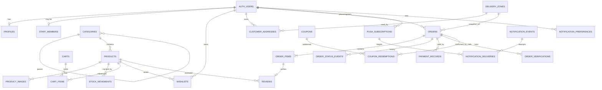

# DATABASE.md

Status: Draft v0.1 (planning). Part of the coordinated spec set: ARCHITECTURE.md, API_SPEC.md, SECURITY.md, PHASES.md, TEST_PLAN.md, DECISIONS.md.

Decisions this document implements: D-001 (one Supabase project per vendor), D-002 (PostgreSQL on Supabase), D-003 (Supabase client + RLS + SQL migrations + RPC functions; **Prisma is not used**), D-006 (inventory reservation), D-007 (manual payments), D-008 (notification outbox), D-012 (operator break-glass access).

Anything not yet confirmed is listed in section 16 (Assumptions and open questions).

---

## 1. Conventions

| Topic | Rule |
|---|---|
| Source of truth | SQL migration files in `supabase/migrations/`, applied by the Supabase CLI. Generated TypeScript types come from the database. |
| Primary keys | `uuid` with `default gen_random_uuid()`, except append-only logs (`bigint generated always as identity`). |
| Timestamps | `timestamptz`, `created_at default now()`, `updated_at` maintained by trigger. |
| Money | Integer **paisa** in `bigint` columns named `*_paisa`. 1 NPR = 100 paisa. Never floats. Always `check (>= 0)` unless stated. |
| Enums | `text` with `check (... in (...))` (easier to migrate than Postgres enum types). |
| Phone numbers | Stored normalized as E.164 text (for example `+9779812345678`) with a format check. Raw input is not stored separately. |
| Localized text | Paired columns `*_en` (required where shown) and `*_ne` (nullable, falls back to English in the app). |
| Deletion | Catalog and commerce records are archived or status-changed, not hard-deleted. `on delete` behavior is stated per table. |
| Schemas | Application tables live in `public`. Auth is Supabase `auth`. Helper and RPC functions live in `public`; privileged internals in a private schema `app_private` not exposed through the API. |
| Extensions | `pg_trgm`, `citext`, `pgcrypto`, `pg_cron`, `pg_net` (cron and net availability to be verified per plan in Phase 6). |

---

## 2. Entity relationship diagram



Standalone tables: `store_settings`, `audit_logs`, `rate_limit_hits`, `break_glass_sessions`.

---

## 3. Table inventory and justification

Tables from the original brief, plus **six additions** (marked +) with their reason.

| Table | Purpose |
|---|---|
| store_settings | Single-row store configuration (branding, contact, policies, payment instructions, delivery defaults). |
| profiles | Customer profile data attached to `auth.users`. |
| staff_members | Marks which users are staff and their role/permissions. |
| categories | Product categories (one level of parent allowed). |
| products | Sellable items, bilingual text, price, stock, status. |
| product_images | Ordered images per product. |
| + stock_movements | Append-only ledger of every stock and reservation change. Needed to audit inventory, reconcile counts and explain disputes. |
| carts, cart_items | Persistent carts for logged-in users and guests. No prices stored. |
| wishlists | Saved products per logged-in customer. |
| customer_addresses | Saved delivery addresses per customer. |
| delivery_zones | Vendor-defined zones, fees and free-delivery thresholds. |
| orders | Order header with full price and address snapshots. |
| order_items | Line items with name and price snapshots. |
| order_status_events | Append-only status history with actor. |
| payment_records | Payment and refund records, separate from order status. |
| + order_verifications | History of phone confirmation attempts for COD/fake-order prevention. |
| coupons, coupon_redemptions | Discount codes and each use. |
| reviews | Customer reviews with moderation state. |
| push_subscriptions | Web Push endpoints per user or per guest order. |
| notification_preferences | Per-user notification type opt-in/out. |
| notification_events | Outbox of events to deliver. |
| + notification_deliveries | One row per attempt per subscription. Needed for retries and to record honestly that a push was *submitted*, not *seen*. |
| audit_logs | Append-only record of sensitive actions. |
| + rate_limit_hits | Postgres-backed rate limiting, because serverless instances have no shared memory and we avoid adding Redis. |
| + break_glass_sessions | Record of operator support access to a vendor's data (procedural control, see SECURITY.md). |
| daily_metrics | **Not created in MVP.** Reports use SQL views/RPC over indexed tables. Revisit when a report exceeds ~1 s at realistic data volume (see D-016 candidate). |

---

## 4. Data dictionary

Legend: PK primary key, FK foreign key, UQ unique, NN not null, CK check.

### store_settings
Single row (`id smallint primary key default 1 check (id = 1)`).
- `store_name text NN`, `slug text NN`, `logo_path text`, `favicon_path text`
- `theme jsonb NN` (semantic color tokens, validated by Zod in the app and a JSON shape check)
- `contact_phone text`, `whatsapp_number text`, `contact_email text`
- `default_locale text NN CK in ('en','ne')`, `supported_locales text[] NN`, `currency text NN default 'NPR' CK = 'NPR'`
- `business_info jsonb` (legal name, address, PAN, VAT number)
- `policies jsonb` (localized text blocks: returns, privacy, terms)
- `payment_settings jsonb NN` (cod_enabled, manual_enabled, localized manual instructions, QR image path)
- `free_delivery_threshold_paisa bigint CK >= 0` (store default; zone value overrides)
- `unconfirmed_expiry_hours integer NN default 24 CK between 1 and 720`
- `low_stock_default integer NN default 5`
- `max_pending_orders_per_phone integer NN default 3` (fraud heuristic input)
- `deployed_version text` (written by the release script)
- `brand jsonb NN default {}` (vendor brand: `{ "primary": "#RRGGBB", "accent": "#RRGGBB" }`; added in UX Phase 1, UX-D020)
- `ui_v2 boolean NN default false` (rollout flag for the Bazaar Glass UI; removed after one stable release)
- `updated_at`, `updated_by uuid FK auth.users on delete set null`
- Auth: **column-level grants**. `anon` and `authenticated` may select only: `id, store_name, slug, logo_path, favicon_path, theme, brand, ui_v2, contact_phone, whatsapp_number, contact_email, default_locale, supported_locales, currency, payment_settings, policies, free_delivery_threshold_paisa, updated_at`. `authenticated` may additionally select `business_info` (PAN/VAT print on invoices). Operational fields (`unconfirmed_expiry_hours`, `low_stock_default`, `max_pending_orders_per_phone`, `deployed_version`, `updated_by`) are never readable by clients; staff with `settings.manage` get the full row from `public.admin_store_settings()`. Write requires `settings.manage` (RLS update policy). Applied 20 Oct 2026 (the original policy allowed `select *` to everyone).

### profiles
- `id uuid PK FK auth.users(id) on delete cascade`
- `full_name text`, `phone text CK E.164`, `preferred_locale text CK in ('en','ne')`, `created_at`, `updated_at`
- Created by trigger on first Google sign-in. Auth: owner reads/updates own row; staff with `customers.view` read.

### staff_members
- `user_id uuid PK FK auth.users on delete cascade`
- `role text NN CK in ('owner','manager','staff')`
- `permissions text[] NN default '{}'` (extra grants for `staff`, see section 11)
- `is_active boolean NN default true`, `invited_by uuid FK auth.users on delete set null`, `created_at`
- At least one active owner must remain (enforced by trigger on update/delete).
- Auth: read by self and by `staff.manage`; write by `staff.manage` only.

### categories
- `id PK`, `parent_id uuid FK categories(id) on delete restrict`, `slug text NN UQ`, `name_en text NN`, `name_ne text`, `image_path text`, `sort_order int NN default 0`, `is_active boolean NN default true`
- CK: a category cannot be its own parent; depth limited to 2 by trigger.
- Delete: restrict. Deactivate instead.
- Auth: public read where `is_active`; write `products.manage`.

### products
```sql
create table products (
  id uuid primary key default gen_random_uuid(),
  slug text not null unique check (slug ~ '^[a-z0-9]+(-[a-z0-9]+)*$'),
  sku text unique,
  category_id uuid references categories(id) on delete restrict,
  name_en text not null check (char_length(name_en) between 1 and 200),
  name_ne text,
  description_en text,
  description_ne text,
  price_paisa bigint not null check (price_paisa > 0),
  discount_price_paisa bigint,
  discount_label_en text,
  discount_label_ne text,
  stock_quantity integer not null default 0 check (stock_quantity >= 0),     -- physical units not yet shipped
  reserved_quantity integer not null default 0 check (reserved_quantity >= 0), -- held by open orders
  low_stock_threshold integer not null default 5 check (low_stock_threshold >= 0),
  status text not null default 'draft' check (status in ('draft','published','archived')),
  weight_grams integer check (weight_grams > 0),                              -- reserved for future weight-based fees
  units_sold integer not null default 0 check (units_sold >= 0),              -- incremented only on delivery
  rating_sum integer not null default 0 check (rating_sum >= 0),
  review_count integer not null default 0 check (review_count >= 0),
  search_vector tsvector generated always as (
    to_tsvector('simple'::regconfig,
      coalesce(name_en,'') || ' ' || coalesce(name_ne,'') || ' ' ||
      coalesce(description_en,'') || ' ' || coalesce(description_ne,''))
  ) stored,
  published_at timestamptz,
  created_at timestamptz not null default now(),
  updated_at timestamptz not null default now(),
  constraint products_reserved_within_stock check (reserved_quantity <= stock_quantity),
  constraint products_discount_valid check (
    discount_price_paisa is null or (discount_price_paisa > 0 and discount_price_paisa < price_paisa))
);
```
- Available to sell = `stock_quantity - reserved_quantity`.
- Average rating = `rating_sum / review_count`, computed on read. Counters are maintained by the review moderation RPC and reconciled by a nightly check query in the test suite.
- Delete: not allowed once referenced by orders (`order_items.product_id` is `on delete set null`, but the app only archives).
- Auth: public read where `status = 'published'`; staff read all with `products.manage` or `products.view`; write `products.manage`. Stock columns are changed only through RPC (column-level privilege revoked from `authenticated`).
- Future variants: add `product_variants` and a nullable `variant_id` on `cart_items`/`order_items` without changing existing columns.

### product_images
- `id PK`, `product_id FK products on delete cascade NN`, `storage_path text NN`, `alt_en text`, `alt_ne text`, `sort_order int NN default 0`, `is_primary boolean NN default false`, `created_at`
- UQ partial index: one `is_primary` per product.
- Auth: public read for published products' images; write `products.manage`.

### stock_movements (append-only)
- `id bigint identity PK`, `product_id FK products on delete restrict NN`
- `delta_stock integer NN`, `delta_reserved integer NN`
- `reason text NN CK in ('order_reserve','order_release','order_dispatch','manual_adjust','csv_import','return_restock')`
- `order_id uuid FK orders on delete set null`, `actor_id uuid FK auth.users on delete set null`, `note text`, `created_at`
- Auth: read `products.manage`; insert only via RPC; no update/delete (trigger raises).

### carts
- `id PK`, `user_id uuid FK auth.users on delete cascade`, `guest_token_hash bytea`, `expires_at timestamptz NN`, `created_at`, `updated_at`
- CK: exactly one of `user_id`, `guest_token_hash` is set.
- UQ: `user_id` (partial where not null), `guest_token_hash` (partial where not null).
- Guest carts are accessed only through `SECURITY DEFINER` RPCs that take the raw cookie token and compare its SHA-256 hash. Expired guest carts are purged by cron.

### cart_items
- `id PK`, `cart_id FK carts on delete cascade NN`, `product_id FK products on delete cascade NN`, `quantity integer NN CK between 1 and 99`, `added_at`
- UQ `(cart_id, product_id)`. **No price column**: prices are always read live and re-validated at quote time.

### wishlists
- PK `(user_id, product_id)`, both FKs `on delete cascade`, `created_at`. Auth: owner only.

### delivery_zones
- `id PK`, `name_en NN`, `name_ne`, `fee_paisa bigint NN CK >= 0`, `free_threshold_paisa bigint CK >= 0` (null = use store default), `is_active boolean NN default true`, `sort_order int NN default 0`, `notes text`
- Delete: restrict if referenced by saved addresses; orders keep a name/fee snapshot so history is unaffected.
- Auth: public read where active; write `delivery.manage`.

### customer_addresses
- `id PK`, `user_id FK auth.users on delete cascade NN`, `label text`, `recipient_name text NN`, `phone text NN CK E.164`, `delivery_zone_id FK delivery_zones on delete set null`, `address_line text NN`, `landmark text`, `municipality text`, `district text`, `is_default boolean NN default false`, `created_at`, `updated_at`
- UQ partial index: one default per user. Auth: owner only; staff cannot read saved addresses (order snapshots are used instead).

### orders
- `id PK`, `order_number text NN UQ default 'ORD-' || lpad(nextval('order_number_seq')::text, 6, '0')`
- `tracking_token_hash bytea NN UQ` (SHA-256 of a 32-byte random token; the raw token is shown once in the confirmation page/link)
- `idempotency_key text NN UQ`, `request_hash bytea NN`
- `user_id FK auth.users on delete set null` (null for guests)
- Customer snapshot: `customer_name NN`, `customer_phone NN (E.164)`, `customer_email`
- Shipping snapshot: `ship_recipient NN`, `ship_phone NN`, `ship_address_line NN`, `ship_landmark`, `ship_municipality`, `ship_district`, `delivery_zone_id FK on delete set null`, `delivery_zone_name NN`
- `status text NN default 'pending_confirmation' CK in ('pending_confirmation','confirmed','processing','dispatched','delivered','cancelled','rejected')`
- `payment_method text NN CK in ('cod','manual')`
- `payment_status text NN default 'unpaid' CK in ('unpaid','awaiting_verification','verified','rejected','refunded')`
- Money (all `bigint NN CK >= 0`): `items_list_total_paisa`, `item_discount_paisa`, `coupon_discount_paisa`, `delivery_fee_paisa`, `total_paisa`
- `coupon_id FK on delete set null`, `coupon_code text`
- `risk_flags text[] NN default '{}'`, `locale text NN CK in ('en','ne')`, `customer_note text`, `cancel_reason text`
- `placed_at`, `confirmed_at`, `confirmed_by FK auth.users on delete set null`, `updated_at`
- Totals constraint:
```sql
constraint orders_total_consistent check (
  total_paisa = items_list_total_paisa - item_discount_paisa - coupon_discount_paisa + delivery_fee_paisa
  and item_discount_paisa <= items_list_total_paisa
  and coupon_discount_paisa <= items_list_total_paisa - item_discount_paisa)
```
- Immutability: a trigger rejects updates to snapshot and money columns after insert. Only `status`, `payment_status`, `confirmed_*`, `cancel_reason`, `risk_flags`, `updated_at` may change, and only through RPC.
- Delete: never. Retention policy in section 14.
- Auth: customer reads own orders (`user_id = auth.uid()`); staff read with `orders.view`; all writes via RPC. Guests have no direct table access (tracking RPCs only).

### order_items
- `id PK`, `order_id FK orders on delete cascade NN`, `product_id FK products on delete set null`
- Snapshots: `name_en NN`, `name_ne`, `sku`, `image_path`
- `unit_list_price_paisa NN`, `unit_price_paisa NN` (after item-level discount), `quantity integer NN CK > 0`, `line_total_paisa NN`
- CK: `line_total_paisa = unit_price_paisa * quantity` and `unit_price_paisa <= unit_list_price_paisa`.
- Immutable after insert (trigger). Auth follows parent order.

### order_status_events (append-only)
- `id bigint identity PK`, `order_id FK orders on delete cascade NN`, `from_status text`, `to_status text NN`, `actor_type text NN CK in ('customer','staff','system')`, `actor_id FK auth.users on delete set null`, `note text`, `created_at`
- Trigger blocks update/delete. Written only by RPC in the same transaction as the status change.

### payment_records
- `id PK`, `order_id FK orders on delete restrict NN`, `kind text NN CK in ('payment','refund')`, `method text NN CK in ('cod','manual')`, `amount_paisa bigint NN CK > 0`
- `status text NN CK in ('submitted','verified','rejected')`, `reference text`, `proof_path text` (private bucket), `note text`
- `submitted_at`, `verified_by FK auth.users on delete set null`, `verified_at`
- Rule: a customer-submitted proof creates `submitted`, never `verified`. Only `orders.verify_payment` staff can set `verified`, through the RPC, which updates `orders.payment_status`.
- COD: a `payment` record is created at delivery when the vendor records cash collected.

### order_verifications
- `id PK`, `order_id FK orders on delete cascade NN`, `method text NN CK in ('phone_call','whatsapp','other')`, `outcome text NN CK in ('confirmed','no_answer','declined','wrong_number','needs_follow_up')`, `note text`, `actor_id FK auth.users on delete set null`, `created_at`
- Append-only. A `confirmed` outcome is what allows the `pending_confirmation -> confirmed` transition for COD (the RPC checks this unless the actor has `orders.override_confirmation`, which is itself audited).

### coupons
- `id PK`, `code citext NN UQ CK ~ '^[A-Za-z0-9_-]{3,32}$'`, `type text NN CK in ('percent','fixed')`
- `value integer NN` with CK: percent between 1 and 100, fixed > 0 (paisa)
- `max_discount_paisa bigint CK > 0`, `min_subtotal_paisa bigint NN default 0`
- `starts_at`, `ends_at`, `max_redemptions integer CK > 0`, `redemption_count integer NN default 0`, `per_customer_limit integer NN default 1 CK > 0`, `is_active boolean NN default true`, `created_at`
- CK: `max_redemptions is null or redemption_count <= max_redemptions`.
- Auth: not publicly listable. Customers validate a code only through the quote RPC. Write `coupons.manage`.

### coupon_redemptions
- `id PK`, `coupon_id FK on delete restrict NN`, `order_id FK on delete cascade NN`, `user_id FK auth.users on delete set null`, `customer_phone text NN`, `discount_paisa bigint NN`, `status text NN CK in ('applied','released')`, `created_at`, `released_at`
- UQ `(coupon_id, order_id)`. Index on `(coupon_id, customer_phone)` and `(coupon_id, user_id)`.

### reviews
- `id PK`, `product_id FK on delete cascade NN`, `user_id FK auth.users on delete cascade NN`, `order_item_id FK order_items on delete set null`
- `rating smallint NN CK between 1 and 5`, `title text`, `body text CK char_length <= 2000`
- `status text NN default 'pending' CK in ('pending','approved','rejected','hidden')`, `moderated_by FK`, `moderated_at`, `created_at`
- UQ `(product_id, user_id)`. A review is "verified purchaser" when `order_item_id` is set, which the submit RPC allows only when that item belongs to a **delivered** order of the same user and product.
- Auth: public read where `approved`; owner reads own; insert via RPC (login required); moderate `reviews.moderate`.

### push_subscriptions
- `id PK`, `audience text NN CK in ('customer','staff')`, `user_id FK auth.users on delete cascade`, `order_id FK orders on delete cascade` (guest subscriptions tied to one order)
- `endpoint text NN UQ`, `p256dh text NN`, `auth_secret text NN`, `locale text NN`, `user_agent text`
- `created_at`, `last_success_at`, `failure_count int NN default 0`, `revoked_at`
- CK: at least one of `user_id`, `order_id` is set.
- Auth: owner can insert/delete own; **no client SELECT** of keys. Read by the worker via service role only.

### notification_preferences
- PK `(user_id, type)`, `type text NN`, `enabled boolean NN default true`. Auth: owner only. Staff default types are enabled on first subscription.

### notification_events (outbox)
- `id uuid PK`, `type text NN` (for example `order.placed`, `order.confirmed`, `order.dispatched`, `order.delivered`, `order.cancelled`, `stock.low`, `review.pending`)
- Targeting: `audience text NN CK in ('customer','staff')`, `user_id`, `order_id`, `permission text` (for staff fan-out, for example `orders.view`)
- `payload jsonb NN` (**ids and i18n keys only, no names, phones or addresses**)
- `dedupe_key text NN UQ`, `status text NN default 'pending' CK in ('pending','processing','sent','failed','dead')`
- `attempts int NN default 0`, `next_attempt_at timestamptz NN default now()`, `locked_at`, `last_error text`, `created_at`, `processed_at`
- Index for the worker: `(next_attempt_at) where status in ('pending','failed')`.
- Auth: no client access. Staff "notification history" is read through an RPC that returns type, time, status without payload internals.

### notification_deliveries
- `id bigint identity PK`, `event_id FK notification_events on delete cascade NN`, `subscription_id FK push_subscriptions on delete cascade NN`
- `status text NN CK in ('submitted','failed','gone')`, `http_status int`, `error text`, `attempted_at`
- "submitted" means the push service accepted the message. There is no "delivered" or "seen" state because Web Push does not provide one.

### audit_logs (append-only)
- `id bigint identity PK`, `actor_type text NN CK in ('staff','customer','system','operator')`, `actor_id uuid`, `action text NN`, `entity_type text NN`, `entity_id text`, `before jsonb`, `after jsonb`, `request_id text`, `created_at`
- `before/after` hold changed fields only, with phones/addresses redacted (last 3 digits kept). Trigger blocks update/delete. Auth: read `audit.view`.

### rate_limit_hits
- PK `(key text, window_start timestamptz)`, `count integer NN`. Used by `check_rate_limit(key, limit, window_seconds)`. Keys are hashed (IP, phone, user id plus action). Cleaned by cron hourly.

### break_glass_sessions
- `id PK`, `operator_label text NN`, `reason text NN`, `started_at NN`, `expires_at NN`, `ended_at`, `ticket_ref text`
- A **procedural** record: the operator script inserts it before using elevated credentials. The database cannot force this (the project owner can bypass anything), so SECURITY.md pairs it with credential vaulting and a review habit.

---

## 5. Order totals calculation (authoritative)

Computed only on the server inside `quote_checkout` and recomputed inside `place_order`:

1. For each cart item: `unit_list = products.price_paisa`; `unit_price = coalesce(discount_price_paisa, price_paisa)`.
2. `items_list_total = sum(unit_list * qty)`; `item_discount = sum((unit_list - unit_price) * qty)`; `goods = items_list_total - item_discount`.
3. Coupon (validated against active window, `min_subtotal_paisa`, limits):
   - percent: `coupon_discount = min(floor(goods * value / 100), coalesce(max_discount_paisa, goods))`
   - fixed: `coupon_discount = min(value, goods)`
   - Coupons never discount delivery.
4. `goods_after_coupon = goods - coupon_discount`.
5. Delivery: zone required. `threshold = coalesce(zone.free_threshold_paisa, store.free_delivery_threshold_paisa)`. `delivery_fee = 0` if `threshold is not null and goods_after_coupon >= threshold`, else `zone.fee_paisa`.
6. `total = goods_after_coupon + delivery_fee`.

Rounding: percentages floor to whole paisa. All values are snapshotted onto `orders` and `order_items`. Later price or zone changes never alter existing orders.

---

## 6. Inventory model

Two counters per product: `stock_quantity` (physical, unshipped) and `reserved_quantity` (held by open orders). Available = stock - reserved.

| Event | stock_quantity | reserved_quantity | Ledger reason |
|---|---|---|---|
| Order placed | unchanged | `+qty` | order_reserve |
| Cancel/reject/expire before dispatch | unchanged | `-qty` | order_release |
| Dispatched | `-qty` | `-qty` | order_dispatch |
| Cancelled after dispatch (returned) | unchanged until vendor chooses restock | unchanged | (none) |
| Vendor restocks returned goods | `+qty` | unchanged | return_restock |
| Manual stock edit / CSV | `+/- n` | unchanged | manual_adjust / csv_import |

Reservation is an atomic conditional update (no separate read-then-write):

```sql
update products
   set reserved_quantity = reserved_quantity + $qty, updated_at = now()
 where id = $product_id
   and status = 'published'
   and stock_quantity - reserved_quantity >= $qty;
-- if FOUND is false: raise exception 'INSUFFICIENT_STOCK' using detail = $product_id;
```

Lines are processed **in ascending product id order** to avoid deadlocks between concurrent checkouts. The `reserved_quantity <= stock_quantity` check constraint is a second safety net: an overselling bug fails loudly instead of corrupting data. Lowering `stock_quantity` below `reserved_quantity` in a manual edit is rejected with a clear error.

Auto-release: `release_expired_orders()` (cron, every 5 minutes) cancels `pending_confirmation` orders older than `store_settings.unconfirmed_expiry_hours` with `actor_type = 'system'` and `cancel_reason = 'unconfirmed_timeout'`, releasing reservations and coupon redemptions.

---

## 6a. Coupon concurrency

Inside `place_order`:
1. `pg_advisory_xact_lock(hashtextextended(coupon_id::text || ':' || customer_key, 0))` where `customer_key` is `user_id` or the normalized phone. This serializes the per-customer limit check.
2. Count the customer's `applied` redemptions for this coupon. Reject if `>= per_customer_limit`.
3. Atomic global limit:
```sql
update coupons set redemption_count = redemption_count + 1
 where id = $id and is_active
   and (starts_at is null or starts_at <= now())
   and (ends_at is null or ends_at > now())
   and (max_redemptions is null or redemption_count < max_redemptions);
-- not FOUND => raise 'COUPON_UNAVAILABLE'
```
4. Insert `coupon_redemptions(status='applied')`. On cancel/reject/expire: set `released`, decrement `redemption_count`, all in the status-change transaction.

---

## 7. Transaction boundaries (RPC functions)

All are `SECURITY DEFINER` functions in `public` with `set search_path = ''`, explicit `grant execute` to only the roles that need them, and they re-check permissions with `auth.uid()` internally.

| Function | Caller | Transaction contents |
|---|---|---|
| `quote_checkout(cart ref, zone_id, coupon_code, payment_method)` | anon/auth | Read-only totals per section 5. Rate limited. |
| `place_order(...)` | anon/auth | Idempotency check, recompute totals, risk flags, per-customer coupon lock, reserve stock (ordered), redeem coupon, insert order + items + first status event + `notification_events`, clear cart. All-or-nothing. Returns order number and raw tracking token. |
| `transition_order(order_id, to_status, note, expected_status)` | staff | Lock order row `FOR UPDATE`, validate allowed transition and permission, apply inventory/coupon effects, insert status event, outbox events, audit row. `expected_status` prevents lost updates. |
| `cancel_order_by_customer(...)` | customer | Only while `pending_confirmation`; same effects as above. |
| `record_verification(order_id, outcome, note)` | staff | Insert `order_verifications`; if outcome is confirmed and the caller asks, chain into `transition_order`. |
| `submit_payment_proof(order_id, token, reference, proof_path)` | guest/customer | Creates `payment_records(status='submitted')` and sets `orders.payment_status='awaiting_verification'`. |
| `verify_payment(record_id, decision, note)` | staff | Sets record verified/rejected, updates `orders.payment_status`, audit. |
| `record_refund(order_id, amount, note)` | staff | Manual refund bookkeeping only (no gateway). Sets `payment_status='refunded'` when full. |
| `adjust_stock(product_id, delta, reason, note)` | staff | Lock product, validate, update, ledger row. |
| `release_expired_orders()` | cron | Batch auto-cancel as in section 6. |
| `submit_review`, `moderate_review` | customer / staff | Eligibility check, counter maintenance on approve/unapprove. |
| `track_order_by_token(token)`, `track_order_by_number_phone(number, phone)` | anon | Return a minimal tracking view, rate limited, uniform error for not found vs mismatch. |
| `guest_cart_*` | anon | Token-hash checked cart operations. |
| `claim_notification_batch(limit)` | worker (service role) | `SELECT ... FOR UPDATE SKIP LOCKED`, mark `processing`, set `locked_at`. |
| `check_rate_limit(key, limit, seconds)` | internal | Upsert counter, return allowed/denied. |
| `purge_expired_data()` | cron | Guest carts, stale `rate_limit_hits`, old delivered notification rows, revoked subscriptions. |

Allowed order transitions are defined once in an `app_private.order_transition_allowed(from, to)` SQL function; ARCHITECTURE.md contains the diagram and the TypeScript layer imports the same table from generated metadata, with a test asserting both agree.

---

## 8. Index strategy

| Index | Reason |
|---|---|
| `products (status, category_id)` partial where published | Listing and category filtering |
| `products using gin (search_vector)` | Full-text search |
| `products using gin ((name_en || ' ' || coalesce(name_ne,'')) gin_trgm_ops)` | Fuzzy/partial match, works for Nepali text |
| `products (price_paisa)`, `products (published_at desc)` | Sort and filter |
| `products (stock_quantity - reserved_quantity)` partial where low | Low-stock alerts |
| `product_images (product_id, sort_order)` | Gallery |
| `cart_items (cart_id)` | Cart load |
| `orders (status, placed_at desc)` | Dashboard queues |
| `orders (user_id, placed_at desc)` | Customer history |
| `orders (customer_phone, placed_at desc)` | Duplicate/risk checks, search |
| `orders (placed_at)` | Reports |
| `orders` unique on `order_number`, `tracking_token_hash`, `idempotency_key` | Lookups and duplicate prevention |
| `order_items (order_id)`, `(product_id)` | Detail and sales reports |
| `order_status_events (order_id, created_at)` | History |
| `payment_records (order_id)`, `(status) where status='submitted'` | Verification queue |
| `coupon_redemptions (coupon_id, customer_phone)`, `(coupon_id, user_id)` | Per-customer limit |
| `reviews (product_id, status, created_at desc)`, `(status) where pending` | Display and moderation queue |
| `notification_events (next_attempt_at) where status in ('pending','failed')` | Worker polling |
| `push_subscriptions (user_id)`, `(order_id)` | Fan-out |
| `audit_logs (entity_type, entity_id, created_at desc)`, `(created_at desc)` | Audit views |

At the target scale (single-vendor store with thousands of products and tens of thousands of orders) these are sufficient. Add more only after measuring.

---

## 9. Order snapshots

At placement the order stores: customer contact, shipping address text, zone name and fee, every item's name (both languages), SKU, image path, list and sale unit price, coupon code and discount, and all totals. Product edits, price changes, deleted zones or deleted addresses never change a past order or its printed invoice.

---

## 10. Audit log strategy

Written by RPCs for: order transitions, payment verification/refund, stock adjustments, coupon create/edit/disable, staff create/role change/deactivate, settings change, review moderation, CSV import, product price change, break-glass start/stop, and permission-denied events on sensitive RPCs. Append-only via trigger. Fields redacted as in section 4. Staff with `audit.view` read via RPC with filters and pagination. Retention in section 14.

---

## 11. Roles, permissions and database access

Permission keys (authoritative list; SECURITY.md and API_SPEC.md use exactly these):

`products.view`, `products.manage`, `orders.view`, `orders.manage`, `orders.verify_payment`, `orders.override_confirmation`, `customers.view`, `coupons.manage`, `delivery.manage`, `reviews.moderate`, `reports.view`, `csv.manage`, `staff.manage`, `settings.manage`, `audit.view`.

Defaults by role (stored in code and mirrored in a SQL function `app_private.role_permissions(role)`):

| Role | Permissions |
|---|---|
| owner | all |
| manager | all except `staff.manage`, `settings.manage`, `orders.override_confirmation` |
| staff | `products.view`, `orders.view`, `orders.manage` by default; extra grants via `staff_members.permissions` (owner-assigned) |
| customer | no staff permissions; own data only |
| platform operator | **no application role.** Break-glass only (D-012). |

Helper: `app_private.has_permission(p text) returns boolean` (stable, security definer) checks the active `staff_members` row for `auth.uid()`.

Postgres roles: `anon`, `authenticated`, `service_role` as provided by Supabase. `service_role` is used only by the notification worker, cron-triggered maintenance routes and break-glass tooling, never in browser code or customer-facing request handlers.

### RLS policy summary

RLS is enabled on **every** table in `public`; default deny.

| Table | anon | customer (authenticated) | staff |
|---|---|---|---|
| store_settings | select safe view | same | update `settings.manage` |
| profiles | none | own select/update | select `customers.view` |
| staff_members | none | none | select self; manage `staff.manage` |
| categories | select active | same | write `products.manage` |
| products | select published | same | select all (`products.view`/`manage`), write `products.manage` (stock columns via RPC) |
| product_images | select (published products) | same | write `products.manage` |
| stock_movements | none | none | select `products.manage` |
| carts / cart_items | none (RPC) | own | none |
| wishlists, customer_addresses | none | own | none |
| delivery_zones | select active | same | write `delivery.manage` |
| orders / order_items | none (tracking RPC) | own select | select `orders.view` |
| order_status_events, order_verifications | none | select own order's events | select `orders.view`; insert via RPC |
| payment_records | none | select own | select `orders.view`; write via RPC |
| coupons, coupon_redemptions | none | none | `coupons.manage` |
| reviews | select approved | own + insert via RPC | moderate `reviews.moderate` |
| push_subscriptions | insert via RPC | own insert/delete, no select of keys | none |
| notification_preferences | none | own | own |
| notification_events / deliveries | none | none | summary via RPC only |
| audit_logs | none | none | select `audit.view` |
| rate_limit_hits, break_glass_sessions | none | none | none (service/ops only) |

Inserts, updates and deletes on money, stock, status and snapshot columns are **never** granted directly; they go through the RPC functions in section 7.

### Storage buckets

| Bucket | Access | Content |
|---|---|---|
| `product-images` | public read; write `products.manage` | `products/{product_id}/{uuid}.webp` |
| `store-assets` | public read; write `settings.manage` | logo, favicon, payment QR |
| `payment-proofs` | private; signed URLs only; read `orders.verify_payment` | `orders/{order_id}/{uuid}` |

Constraints: MIME allowlist (`image/jpeg`, `image/png`, `image/webp`), max 5 MB per object, enforced by bucket config and re-verified by the finalize route (ARCHITECTURE.md, file upload flow).

---

## 12. Migration strategy

- One migration per change, timestamped, reviewed in a pull request, never edited after merge.
- Forward-only in production. Each destructive change (drop column/table, type narrowing) needs a two-step expand/contract plan across two releases and explicit approval.
- Every migration is tested against a fresh database and against a database seeded from the previous release.
- A migration that cannot be applied cleanly to staging blocks the release.
- The release script (D-013) applies pending migrations to each vendor project one at a time, stopping on first failure, then records `store_settings.deployed_version`.
- Seed data: `supabase/seed.sql` (demo products, zones, coupons) for local/staging/demo only. Production vendors get a minimal onboarding seed (settings row, default zone, owner invite).

---

## 13. Backup and restore

- Production vendor projects must be on a paid Supabase plan. Current public pricing information indicates daily backups (7-day retention) are a paid-plan feature and free projects pause after inactivity; verify current terms before each vendor go-live.
- In addition to provider backups, a scheduled `pg_dump` per vendor (weekly at minimum) is stored encrypted in storage owned by the operator, with the key kept in the secrets manager. This also protects against account-level problems.
- Storage objects (images) are backed up separately with a documented script.
- Restore procedure (documented and **tested in Phase 8**): restore into a **new** Supabase project, verify row counts and a smoke test, then repoint the vendor's environment variables. Never restore over production without a snapshot first.
- Restoring one vendor never affects others, because projects are isolated (D-001).

---

## 14. Privacy and retention (proposed, needs vendor/legal confirmation)

| Data | Proposed retention |
|---|---|
| Orders, items, payment records (accounting data) | Kept; confirm statutory minimum with the vendor's accountant. Customer PII on orders may be anonymized on request once the retention minimum has passed. |
| Guest carts | Delete after 30 days idle |
| Push subscriptions | Delete when revoked, expired (410/404) or after repeated failures |
| Notification events and deliveries | 90 days |
| Rate limit counters | 24 hours |
| Audit logs | 2 years minimum |
| Payment proof images | Delete 90 days after the order is delivered or cancelled, unless the vendor needs longer |
| Profiles | Deleted on account deletion request; orders keep a snapshot with `user_id` set to null |

---

## 15. Cross-document alignment checklist

- Order and payment status values here match ARCHITECTURE.md state machine, API_SPEC.md enums and DESIGN.md labels.
- Permission keys here are the only keys used in SECURITY.md, API_SPEC.md and tests.
- RPC names here are the transaction boundaries cited in API_SPEC.md.
- Table list here is covered by TEST_PLAN.md RLS tests (one allow and one deny case per table).

---

## 16. Assumptions and open questions

1. Retention periods in section 14 are proposals pending accountant/legal review (**required before commercial production**).
2. `pg_cron` and `pg_net` availability and limits must be verified on the chosen Supabase plan (**required before Phase 6**).
3. `daily_metrics` is deferred. Revisit if reporting queries are slow (**optional enhancement**).
4. Product variants are a **future extension**; `weight_grams` is a placeholder for future weight-based delivery.
5. Supabase image transformations are not assumed; images are resized client-side before upload (see ARCHITECTURE.md).
6. Per-vendor cost figures are estimates and must be rechecked against current Supabase and Vercel pricing at go-live.
